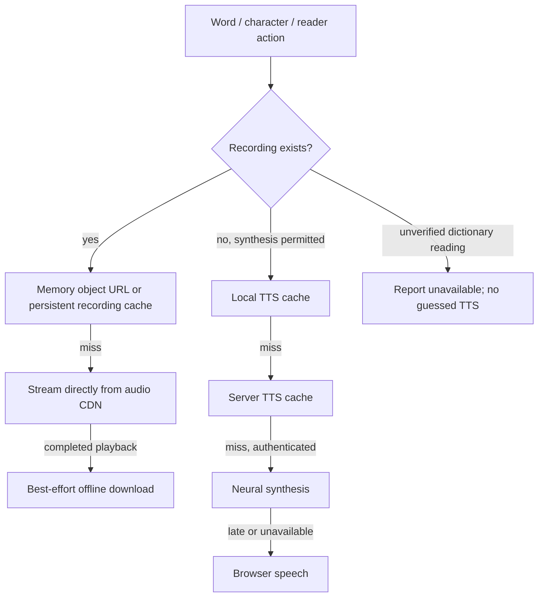

# 🔌 Express API Specification

The backend (`server/index.ts`) runs under Node.js + Express and provides neural TTS synthesis + caching endpoints. Static audio assets stream directly from the CDN edge / bucket storage (`VITE_AUDIO_BASE_URL`), bypassing the application server. Card audio may also be a complete HTTPS URL, including a temporary signed link. Playback does not require CDN CORS headers; background offline caching is best-effort and does. In development it also mounts the Vite dev-server middleware; in production it serves the built `dist/` directory and falls back to `index.html` for app routes.

There is no runtime Jev grading endpoint. `POST /api/jev/grade-answer` returns 404 without authenticating or calling a provider. Jev content-review scripts remain development tooling.

## 🚦 Rate limits

Every endpoint is rate limited per client IP. Exceeding a limit returns
`429` with `{ "error": "Too many requests. Try again later." }`
plus the standard `RateLimit-*` headers.

| Endpoint | Limiter | Window | Limit |
| --- | --- | --- | --- |
| `POST /api/tts` | `apiLimiter` + authenticated user limiter | 1 min | 60/IP, 30/user; 600/user/day by default |
| `GET /api/tts-cache/:text` | `apiLimiter` | 1 min | 60 |
| `GET /api/tts/:voice/*` | `apiLimiter` | 1 min | 60 |

---

## 🎴 Endpoints

The client reuses course recordings for dictionary/custom cards only when the exact word (or its stored simplified/traditional alias) and tone-bearing pinyin match. Unverified readings do not automatically fall back to text-only TTS. Textbook fallback and reader/sentence behavior retain their existing policy.

Recording playback checks the existing persistent audio cache before streaming a cache miss directly from the CDN. Card sessions preload the next two cards during idle time. Mixed quizzes prepare only the current and next question, including their eligible character clips, rather than the whole round. Retained recording object URLs are capped at 100 entries and 25 MiB; the existing persistent recording cache retains its 150 MiB limit. The separate local TTS cache is capped at 100 entries and 25 MiB. CacheStorage and IndexedDB availability, browser eviction, and CDN CORS determine offline availability.

### Neural TTS Synthesis
Synthesizes Mandarin speech server-side, caches the MP3 in Cloudflare R2, and streams it back.
The browser only uses this route for text with no recorded audio file.
- **Method**: `POST`
- **Path**: `/api/tts`
- **Headers**: `Content-Type: application/json`, and `Authorization: Bearer <supabase access token>`
  (**required** — anonymous callers get `401`; the client falls back to browser speech synthesis).
- **Body**: `{ "text": string, "voice"?: string }`. Text must be a string; it is trimmed and limited to 500 Unicode code points. Plain text is XML-escaped before it reaches the provider; client markup cannot supply SSML.
  `voice` defaults to `zh-CN-XiaoxiaoNeural`; an unknown voice also falls back to that default. The
  accepted client voice names are `zh-CN-XiaoxiaoNeural`, `zh-CN-YunxiNeural`,
  `zh-TW-HsiaoChenNeural`, and `zh-TW-YunJheNeural`.
- **Provider**: The unofficial `msedge-tts` package sends text to Microsoft's text-to-speech
  service and returns 24 kHz, 48 kbps mono MP3 at speaking rate 0.9. No Azure Speech resource
  or Azure credentials are used.
- **Caching**: Cloudflare R2 bucket (`R2_BUCKET_NAME`) via `server/ttsStore.ts` (falls back to the
  Supabase `vocabulary-audio` bucket when `R2_*` is unset) at
  `tts/<voice>/<hex-encoded text>.mp3` (best effort — a failed cache
  write never blocks playback), fronted by the same memory cache and synthesis deduplication as the
  cache-only routes. Memory is capped at 1,000 entries and 32 MiB. `POST` responses use `Cache-Control: private, max-age=86400`; cache-only GET responses use `public, max-age=86400`.
- **Responses**:
  - `200 OK`: `audio/mpeg` payload (also honours `If-None-Match`/`Range` as described above).
  - `400 Bad Request`: Missing or empty `text`.
  - `401 Unauthorized`: Missing, malformed, or invalid access token.
  - `502 Bad Gateway`: Synthesis provider unavailable.

### TTS Cache Lookup by Text
Serves an already-synthesized MP3 for a text/voice pair, so the client can check the cache before
paying for synthesis. Read-only — never synthesizes.
- **Method**: `GET`
- **Path**: `/api/tts-cache/:text?voice=<voiceName>` (`:text` is URL-encoded; `voice` defaults to
  `zh-CN-XiaoxiaoNeural`).
- **Headers**: None required.
- **Responses**:
  - `200 OK`: `audio/mpeg` payload, `Cache-Control: public, max-age=86400`.
  - `400 Bad Request`: Empty text or an unrecognized voice.
  - `404 Not Found`: `{ "error": "TTS audio not cached" }` — the client then synthesizes via
    `POST /api/tts`.
  - `500 Server Error`: Cache read failure.

### TTS Cache Read by Voice
Direct read of a cached TTS file by its storage path, mirroring the object URL layout.
- **Method**: `GET`
- **Path**: `/api/tts/:voice/*` (e.g. `/api/tts/zh-CN-XiaoxiaoNeural/5f7a...c1.mp3`)
- **Headers**: None required.
- **Responses**:
  - `200 OK`: `audio/mpeg` payload, `Cache-Control: public, max-age=86400`.
  - `400 Bad Request`: Missing cache filename.
  - `404 Not Found`: `{ "error": "TTS audio not found" }`.
  - `500 Server Error`: Cache read failure.

---

## 🔧 Configuration

| Variable | Purpose |
| --- | --- |
| `PORT` | Listen port (default `3000`). |
| `NODE_ENV` | `production` serves `dist/`; anything else mounts the Vite dev middleware. |
| `R2_ACCOUNT_ID` (or `R2_ENDPOINT`), `R2_ACCESS_KEY_ID`, `R2_SECRET_ACCESS_KEY`, `R2_BUCKET_NAME` | Cloudflare R2 TTS cache. Unset = Supabase Storage fallback. |

Supabase credentials are read by the server-owned client in `server/supabase.ts`; the server never
imports browser application code.

The client contract lives in `src/services/audio/speechEngine.ts`: Cache API → `GET
/api/tts-cache/:text` → `POST /api/tts` with the Supabase access token, retrying the cache lookup
with a 10-second network deadline. HTTP 429/502/503 pauses remote TTS requests for 30 seconds while local cache hits remain available.

## Audio lifecycle and operational limits

- Recorded downloads deduplicate at the shared transport. Each caller owns its cancellation; only the last canceled subscriber aborts the HTTP request. A fresh request can start immediately without inheriting a canceled promise. Lookahead remains sequential to keep foreground streaming responsive. Skipping quiz preparation cancels that preparation queue immediately.
- Downloads bypass potentially non-CORS media responses in the browser HTTP cache. Empty, partial, non-audio and over-25-MiB responses are rejected. Cache hits require no network request. Mutable recordings are due for refresh online after one day. Foreground cache playback can use a stale recording even if the browser incorrectly reports that it is online; a completed play attempts refresh in the background. Cache lookups yield to streaming after one second if storage is unresponsive. Hash-named pronunciation and supplemental recordings are immutable. Browser eviction and unavailable storage can still remove offline coverage.
- Recording persistence is capped at 150 MiB using actual cached response sizes. IndexedDB stores recency only; failed metadata writes no longer disable byte enforcement. Cache Storage itself may reject writes under quota pressure; playback still streams.
- HTML audio uses two reusable elements, unlocked before the first pointer or keyboard action. Neural blobs reuse an unlocked element and revoke their temporary URL on completion/interruption. No unused Web Audio context is created. Requested playback speeds preserve pitch.
- Word/neural startup and stall deadlines are 2.5 seconds; reader ranges allow 10 seconds. Canceled/failed play promises settle, metadata seek handlers detach, and stale callbacks cannot restart an earlier clip. Reader loops restart only after successful completion, and reader TTS mode applies to sentence taps too.
- Browser speech has a 2.5-second startup watchdog and a generous text-length completion watchdog; canceling playback clears both. A missing Chinese voice settles without using an unrelated language.
- Client TTS shares requests, prepares at most two texts concurrently, and caps persistent storage at 100 entries / 25 MiB. The playback deadline includes local cache reads; a delayed result cannot replace a newer utterance. Remote requests stop after 10 seconds. A timeout may finish warming the cache after the foreground has used browser speech, but it cannot start late playback.
- Server object reads and R2 writes allow five seconds. Neural synthesis allows 15 seconds, at most four distinct concurrent cache/synthesis operations and at most 4 MiB per output. Connections and streams close on success/error/timeout; storage writes run outside the response's critical path. The fallback Supabase upload API has no per-upload abort option in the installed SDK, so a pending upload does not hold the response.
- Byte ranges support bounded, open and suffix requests; oversized suffixes return the whole object as a 206. Invalid ranges return 416. `If-Range` mismatches send the whole current object; 304 responses retain validators and caching headers.

### Remaining deployment and content considerations

- Production audio should use an R2 custom domain, not the rate-limited development endpoint. Enable edge caching and verify CORS separately for every production/preview origin. See [DEPLOY.md](DEPLOY.md) and [Cloudflare public bucket guidance](https://developers.cloudflare.com/r2/buckets/public-buckets/).
- `msedge-tts` is an unofficial dependency on Microsoft's service, with no application-level availability guarantee. Course recordings remain the primary source. Browser fallback can differ in voice quality and pronunciation; a provider migration requires a separate decision and listening review.
- Book 1 reader tracks are hosted; Books 2–4 readers currently use speech synthesis. All four books have vocabulary recording references. Polyphonic readings, tone sandhi and context-only character sounds deliberately limit isolated-tile audio; silence for an unsafe tile is preferable to teaching the wrong reading.
- Rate limits, daily counters, memory caches and request deduplication are per process. Multiple replicas multiply limits and can synthesize the same miss. Current limits bound each process; a shared budget/store is needed before treating these as fleet-wide limits.
- Cache byte limits bound retained files/object URLs, not the browser's decoded media buffers or all process memory. Mutable in-memory URLs expire online after one day; persistent recordings refresh in the background after completed playback; replace published recordings under versioned filenames for immediate, reliable corrections. Expired signed URLs cannot be refreshed automatically, and downloading a signed clip does not erase that offline copy when its URL expires.
- Store only language-learning text in the shared/public TTS cache. Do not treat synthesized text as private: cache paths encode text and GET cache routes are public. Source rights, pronunciation quality and alignment accuracy require review beyond successful object existence/decoding.
- Safari/iOS autoplay policies and OS voice availability require device checks; desktop testing cannot certify every phone. Keep current OS/browser versions: Supabase [announced retirement of legacy CBC TLS ciphers](https://supabase.com/changelog/cbc-tls-ciphers-deprecated) starting November 10, 2026 at the earliest, affecting obsolete clients.
