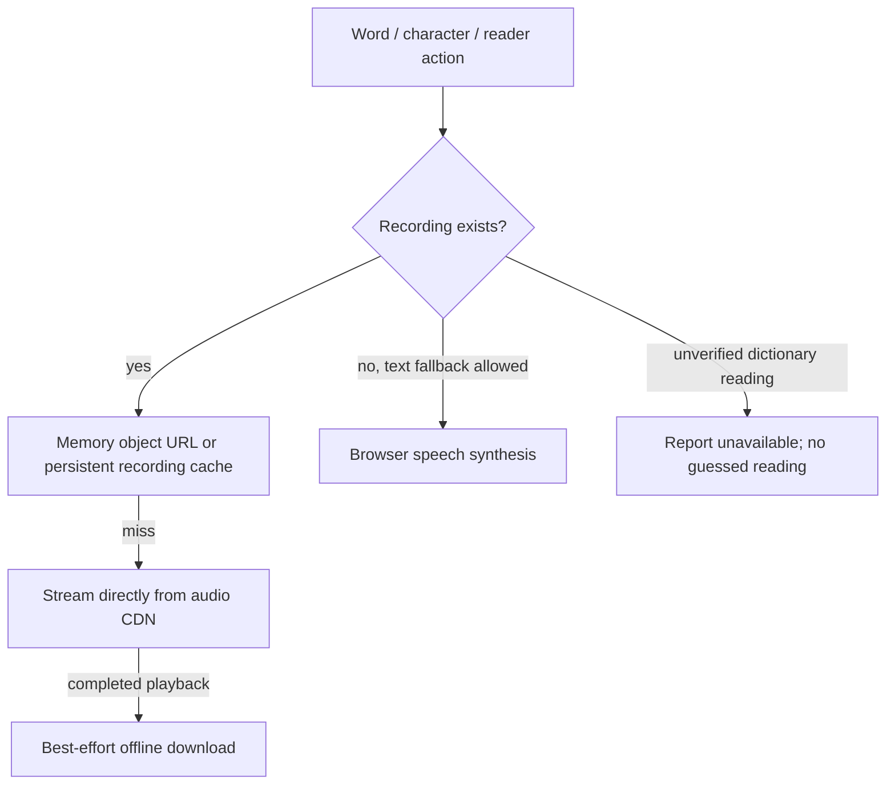

# 🔌 Express API Specification

The backend (`server/index.ts`) runs under Node.js + Express and serves protected lesson content. Static audio assets stream directly from the CDN edge / bucket storage (`VITE_AUDIO_BASE_URL`), bypassing the application server. Card audio may also be a complete HTTPS URL, including a temporary signed link. Playback does not require CDN CORS headers; background offline caching is best-effort and does. In development it also mounts the Vite dev-server middleware; in production it serves the built `dist/` directory and falls back to `index.html` for app routes.

There is no runtime Jev grading endpoint. `POST /api/jev/grade-answer` returns 404 without authenticating or calling a provider. Jev content-review scripts remain development tooling.

Protected lesson-content requests require a valid Supabase user and `has_beta_access() = true` from a request-scoped database client. Unauthorized school-beta accounts receive 403; an access-verification outage returns 503. The database owns the student/owner rule; Express does not duplicate it or trust editable user metadata.

## 🚦 Rate limits

Protected lesson-content requests are limited per client IP and authenticated user. Exceeding a limit
returns `429` with `{ "error": "Too many requests. Try again later." }` and standard `RateLimit-*`
headers.

| Request | Limiter | Window | Limit |
| --- | --- | --- | --- |
| Protected lesson content | `apiLimiter` + authenticated user limiter | 1 min | 60/IP, 600/user |

---

## 🎴 Endpoints

### Health check

- **Method**: `GET`
- **Path**: `/healthz`
- **Response**: `200 OK` with `{ "ok": true }`.

### Protected lesson content

Production serves built packs and page scans from `/data/**`. `GET` and `HEAD` requests require a valid
Supabase bearer token and beta access. Missing or invalid sessions return `401`; accounts without beta
access return `403`; verification outages return `503`. Responses use `Cache-Control: private, no-store`.

The client reuses course recordings for dictionary/custom cards only when the exact word (or its stored simplified/traditional alias) and tone-bearing pinyin match. Unverified readings do not automatically fall back to browser speech. Textbook fallback and reader/sentence behavior retain their existing policy.

Recording playback checks the existing persistent audio cache before streaming a cache miss directly from the CDN. Card sessions preload the next two cards during idle time. Mixed quizzes prepare only the current and next question, including their eligible character clips, rather than the whole round. Retained recording object URLs are capped at 100 entries and 25 MiB; the existing persistent recording cache retains its 150 MiB limit. CacheStorage and IndexedDB availability, browser eviction, and CDN CORS determine offline availability.

Vocabulary packs reference verified, hash-named copies under `vocabulary-trimmed/v1/` where leading silence was safely reduced. These copies retain 80–160 ms before detected sound and preserve decoded speech without MP3 re-encoding; `content/audio/vocabulary_trim.json` records source hashes and measured cut points. Already-short clips keep their original reference. Character sounds, supplements, and reader timing are unchanged; explicit legacy URLs still identify the preserved originals. Pipeline commands are in [DEPLOY.md](DEPLOY.md#vocabulary-leading-silence-pipeline).

## 🔧 Configuration

| Variable | Purpose |
| --- | --- |
| `PORT` | Listen port (default `3000`). |
| `NODE_ENV` | `production` serves `dist/`; anything else mounts the Vite dev middleware. |
| `SENTRY_DSN` | Optional server-side error reporting; disabled when unset. |

Supabase credentials are read by the server-owned client in `server/supabase.ts`; the server never
imports browser application code.

Recorded clips remain the primary audio source. Text without an eligible recording uses the browser's `speechSynthesis`: `zh-TW` for traditional characters and `zh-CN` for simplified characters.
Unverified dictionary readings keep the no-guess rule.

## Audio lifecycle and operational limits

- Recorded downloads deduplicate at the shared transport. Each caller owns its cancellation; only the last canceled subscriber aborts the HTTP request. A fresh request can start immediately without inheriting a canceled promise. Lookahead remains sequential to keep foreground streaming responsive. Skipping quiz preparation cancels that preparation queue immediately.
- Downloads bypass potentially non-CORS media responses in the browser HTTP cache. Empty, partial, non-audio and over-25-MiB responses are rejected. Cache hits require no network request. Mutable recordings are due for refresh online after one day. Foreground cache playback can use a stale recording even if the browser incorrectly reports that it is online; a completed play attempts refresh in the background. Cache lookups yield to streaming after 100 ms online, or one second offline, if storage is unresponsive. Hash-named pronunciation and supplemental recordings are immutable. Browser eviction and unavailable storage can still remove offline coverage.
- Recording persistence is capped at 150 MiB using actual cached response sizes. IndexedDB stores recency only; failed metadata writes no longer disable byte enforcement. Cache Storage itself may reject writes under quota pressure; playback still streams.
- HTML audio uses two reusable elements, unlocked before the first pointer or keyboard action. An already-loaded stream or offline blob replays or seeks on the same element before cache-expiry checks, without consulting disk or replacing its source. Background persistence/refresh still runs after completion. Queued `abort`/`emptied` events from replacing the previous source do not finish the new playback; actual play-promise failures, media errors and timeouts still settle it. No unused Web Audio context is created. Requested playback speeds preserve pitch.
- Recorded-word startup has a 2.5-second deadline; reader ranges allow 10 seconds. Canceled/failed play promises settle, metadata seek handlers detach, and stale callbacks cannot restart an earlier clip. Reader loops restart only after successful completion, and reader speech mode applies to sentence taps too.
- Browser speech has a 2.5-second startup watchdog and a generous text-length completion watchdog; canceling playback clears both. A missing Chinese voice settles without using an unrelated language.
- Byte ranges support bounded, open and suffix requests; oversized suffixes return the whole object as a 206. Invalid ranges return 416. `If-Range` mismatches send the whole current object; 304 responses retain validators and caching headers.

### Remaining deployment and content considerations

- Production audio should use an R2 custom domain, not the rate-limited development endpoint. Enable edge caching and verify CORS separately for every production/preview origin. See [DEPLOY.md](DEPLOY.md) and [Cloudflare public bucket guidance](https://developers.cloudflare.com/r2/buckets/public-buckets/).
- Browser speech voice quality and pronunciation depend on the voices available on each device and browser.
- Book 1 reader tracks are hosted; Books 2–4 readers currently use speech synthesis. All four books have vocabulary recording references. Polyphonic readings, tone sandhi and context-only character sounds deliberately limit isolated-tile audio; silence for an unsafe tile is preferable to teaching the wrong reading.
- Rate limits are per process, so multiple replicas multiply the limit. Current limits bound each process; a shared store is needed before treating them as fleet-wide limits.
- Cache byte limits bound retained files/object URLs, not the browser's decoded media buffers or all process memory. Mutable in-memory URLs expire online after one day; persistent recordings refresh in the background after completed playback; replace published recordings under versioned filenames for immediate, reliable corrections. Expired signed URLs cannot be refreshed automatically, and downloading a signed clip does not erase that offline copy when its URL expires.
- Safari/iOS autoplay policies and OS voice availability require device checks; desktop testing cannot certify every phone. Keep current OS/browser versions: Supabase [announced retirement of legacy CBC TLS ciphers](https://supabase.com/changelog/cbc-tls-ciphers-deprecated) starting November 10, 2026 at the earliest, affecting obsolete clients.

## Dictionary and lesson preparation

`GET /api/dictionary/search?q=…&limit=30` returns at most 50 ranked results. Queries are capped at 128 characters and four wildcards. `POST /api/dictionary/lookup` accepts `{ "words": ["你好"] }` (at most 64 words) and returns a word-to-dictionary-rows object. `POST /api/dictionary/course` accepts the same body and returns matching course cards, including reading-specific recordings. `GET /api/dictionary/examples?word=…&limit=3` returns up to 30 examples. These endpoints require the same verified school session as lesson content, use `private, no-store` and `Vary: Authorization`, and share the 60/IP/minute limiter with protected content; dictionary calls also have a 180/user/minute limit. Invalid requests return 400; unavailable search returns 503 and the client exposes a retryable error.

The server keeps one lazy dictionary worker per process. Character/Latin postings narrow candidates before the shared ranking engine runs; typo and segmentation fallback retain the original corpus semantics. The worker isolates parsing and searching from HTTP/authentication. Its exact-shard cache holds eight shards and its result cache 96 queries. At most 32 jobs queue; startup and query deadlines return errors instead of leaving a permanent spinner. Global search requires a connection; warm lesson definitions remain available in memory.

The Vite build derives `/data/study/manifest.json` and hashed lesson-part JSON bundles from the canonical vocabulary, flashcard-extras and dictionary packs. Each bundle contains its cards, full precomputed examples/hooks, matching dictionary rows plus bounded reference targets, and existing audio references. Repeated example sentences share a table. Brotli/gzip sidecars are generated once at build time and negotiated by Express **after** authentication; shared caches remain disabled. No authored data or audio is transcoded. Development generates equivalent temporary artifacts under `.vite/study`; production reads only `dist/`.

Normal lesson selection loads only selected part bundles. Large selections first use the book's thin vocabulary pack, then prepare an initial 128-card working set. The existing preparation screen waits for examples, local definitions, four initial recordings and the first playable recording; cancel, timeout and retry remain available. It does not preload the full dictionary index or all-book vocabulary. Eight decoded bundles remain resident when idle; a mounted session pins its working parts until close. Dictionary popovers use bundled examples immediately; other words request a small server response. `npm run perf:check` enforces the existing shell budgets, absence of a browser dictionary worker, and a 250 kB Brotli ceiling per study part.
